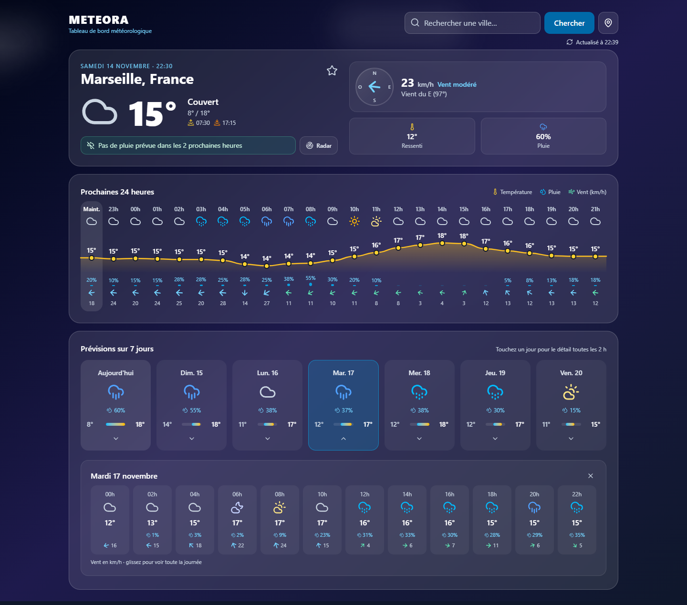
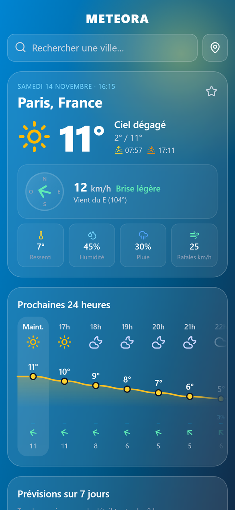

<div align="center">


# Meteora

**La météo en temps réel, claire et installable sur votre téléphone.**

[](https://github.com/romainroussel29/meteora/actions/workflows/ci.yml)


### [🌐 Ouvrir la démo](https://meteora-ten-sooty.vercel.app)

</div>

---

## 📸 Aperçu

<table>
  <tr>
    <td width="70%" align="center"><br /><sub>Ordinateur : météo actuelle, 24 h et détail d'un jour toutes les 2 h</sub></td>
    <td width="30%" align="center"><br /><sub>iPhone</sub></td>
  </tr>
</table>

---

## ✨ Fonctionnalités

| | |
| --- | --- |
| 🌡️ **Météo actuelle** | Température, ressenti, humidité, risque de pluie, min / max, lever et coucher du soleil |
| 🧭 **Vent** | Boussole avec flèche orientée, taille et couleur selon la force, échelle de Beaufort et rafales |
| ⏱️ **24 heures** | Courbe de température, pluie et vent heure par heure, défilement au doigt sur mobile |
| 📅 **7 jours** | Températures min / max à l'échelle de la semaine ; un clic ouvre le détail **toutes les 2 h** |
| 🎨 **Fond animé** | Soleil, étoiles, nuages, pluie, neige, orage ou brouillard selon la météo réelle |
| 📍 **Géolocalisation** | Météo du lieu où l'on se trouve à chaque ouverture, avec le vrai nom de la ville |
| 🔎 **Recherche** | Autocomplétion des villes, utilisable entièrement au clavier |
| ⭐ **Favoris** | Villes favorites et dernière ville consultée mémorisées |
| 📱 **Application** | Installable sur iPhone, Android et ordinateur, fonctionne hors ligne |

> 💡 Pour voir les fonds animés sans attendre la bonne météo, ajoutez `?meteo=` à l'adresse :
> [`?meteo=neige`](https://meteora-ten-sooty.vercel.app/?meteo=neige) ·
> [`?meteo=orage`](https://meteora-ten-sooty.vercel.app/?meteo=orage) ·
> [`?meteo=pluie`](https://meteora-ten-sooty.vercel.app/?meteo=pluie) ·
> [`?meteo=nuit`](https://meteora-ten-sooty.vercel.app/?meteo=nuit) ·
> [`?meteo=brouillard`](https://meteora-ten-sooty.vercel.app/?meteo=brouillard)

---

## 📱 Installer l'application

Meteora est une **PWA** (*Progressive Web App*) : elle s'installe directement depuis le navigateur, sans passer par un store.

| Appareil | Marche à suivre |
| --- | --- |
| **iPhone / iPad** | Ouvrir le site dans **Safari** → **Partager** → **Sur l'écran d'accueil** |
| **Android** | Ouvrir le site dans **Chrome** → menu **⋮** → **Installer l'application** |
| **Ordinateur** | Dans Chrome ou Edge, cliquer sur l'icône d'installation de la barre d'adresse |

Une fois installée, l'application s'ouvre en plein écran et affiche les dernières prévisions même sans connexion.

---

## 🛠️ Points techniques

Ce projet fait partie de mon portfolio. Voici les choix techniques qui me semblaient importants :

- **Hooks personnalisés** : `useWeather` (chargement, erreurs, mémorisation), `useFavorites` et `useOnlineStatus` (avec `useSyncExternalStore`) gardent les composants simples.
- **Requêtes robustes** : vérification des erreurs HTTP et annulation des requêtes obsolètes avec `AbortController`. Une réponse lente ne peut jamais écraser une recherche plus récente.
- **Autocomplétion optimisée** : *debounce* de 300 ms et pattern ARIA *combobox* (↑ ↓, Entrée, Échap).
- **Graphique sans librairie** : courbe de température en SVG (courbes de Bézier) et défilement horizontal maison (doigt, glisser à la souris, flèches).
- **Animations en CSS pur** : le fond météo n'utilise aucune librairie et respecte le réglage « réduire les animations ».
- **PWA** : manifeste, icônes, *service worker* écrit à la main (cache de l'application, réseau d'abord pour la météo, secours hors ligne), prise en compte de l'encoche de l'iPhone.
- **Qualité** : 60 tests unitaires avec Vitest sur la logique métier, ESLint, et intégration continue GitHub Actions (lint + tests + build) à chaque push.

### Stack

| Domaine | Outils |
| --- | --- |
| Interface | React 19, Tailwind CSS 4, Lucide React |
| Build | Vite |
| Tests et qualité | Vitest, ESLint, GitHub Actions |
| Données | [Open-Meteo](https://open-meteo.com/) (prévisions et recherche de villes, sans clé API), [Nominatim / OpenStreetMap](https://nominatim.org/) (nom de la ville à partir de la position) |
| Hébergement | Vercel (déploiement automatique à chaque push) |

---

## 🚀 Lancer le projet en local

**Prérequis :** Node.js 22 ou plus récent.

```bash
git clone https://github.com/romainroussel29/meteora.git
cd meteora
npm install
npm run dev
```

L'application est alors disponible sur `http://localhost:5173`.

| Commande | Description |
| --- | --- |
| `npm run dev` | Serveur de développement |
| `npm test` | Tests unitaires |
| `npm run test:watch` | Tests en mode surveillance |
| `npm run lint` | Analyse du code avec ESLint |
| `npm run build` | Version de production |
| `npm run preview` | Aperçu de la version de production (avec le mode hors ligne) |

---

## 📂 Structure du projet

```text
src/
├── components/     # Interface : météo actuelle, 24 h, 7 jours, recherche, favoris, fond animé…
├── hooks/          # useWeather, useFavorites, useOnlineStatus
├── utils/          # API, géolocalisation, vent, icônes, découpage horaire, stockage
│   └── __tests__/  # Tests unitaires Vitest
├── App.jsx         # Assemblage de l'interface
└── main.jsx        # Point d'entrée + enregistrement du service worker
public/
├── manifest.webmanifest   # Description de l'application installable
├── sw.js                  # Service worker (cache et hors ligne)
└── icons/                 # Icônes de l'application
```

---

## 👤 Auteur

**Romain Roussel**, développeur web
[GitHub @romainroussel29](https://github.com/romainroussel29)

<sub>Données météo fournies par [Open-Meteo](https://open-meteo.com/) · Géocodage © contributeurs [OpenStreetMap](https://www.openstreetmap.org/copyright)</sub>
