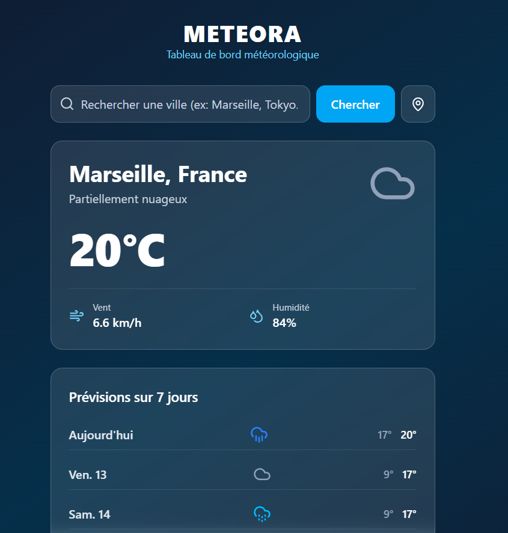

# 🌤️ Meteora - Tableau de bord météorologique

[](https://github.com/romainroussel29/meteora/actions/workflows/ci.yml)

**Meteora** est une application web moderne et responsive pour consulter la météo en temps réel, les prévisions heure par heure et sur 7 jours (avec détail matin / après-midi) pour n'importe quelle ville du monde. Ce projet fait partie de mon portfolio de développeur web : il montre ma maîtrise de React (hooks personnalisés, gestion d'état, accessibilité), de l'intégration d'API REST et d'une architecture propre et testée.

🔗 **[Voir la démo en ligne](https://meteora-ten-sooty.vercel.app)**

---

## 📸 Aperçu de l'application



---

## ✨ Fonctionnalités

### Météo
* **Météo actuelle détaillée :** température, ressenti, conditions (codes WMO), humidité, risque de pluie, min/max du jour, heures de lever et de coucher du soleil.
* **Vent :** boussole avec une flèche qui indique le sens du vent ; sa taille et sa couleur varient avec la vitesse. Libellé selon l'échelle de Beaufort (« Brise légère », « Vent fort »…), direction cardinale et rafales.
* **Prévisions heure par heure (24 h) :** courbe de température lissée en SVG, probabilité de pluie et vent pour chaque heure. Sur grand écran, les 24 heures tiennent dans la largeur ; sur mobile et tablette, on les fait défiler au doigt, sans barre de défilement visible.
* **Prévisions sur 7 jours :** barre de températures min/max à l'échelle de la semaine. **Un clic sur un jour** affiche le détail **matin / après-midi** (temps dominant, température moyenne, pluie, vent).
* **Icônes jour / nuit et fond dynamique :** le dégradé de fond change selon la météo (soleil, pluie, neige, orage…) et passe en mode nuit après le coucher du soleil.

### Recherche & navigation
* **Autocomplétion intelligente :** suggestions de villes en temps réel avec un **debounce (300 ms)**. Chaque requête obsolète est annulée (`AbortController`).
* **Accessible au clavier :** navigation dans les suggestions avec ↑ ↓, Entrée pour valider, Échap pour fermer (pattern ARIA *combobox*).
* **Géolocalisation automatique :** à chaque ouverture, l'application affiche la météo du lieu où l'on se trouve (si l'utilisateur l'autorise), avec **géocodage inverse** pour afficher le vrai nom de la ville. En cas de refus, elle rouvre la dernière ville consultée. Un bouton permet aussi de se relocaliser à tout moment.
* **Villes favorites :** ajout en un clic (⭐) ; les favoris sont accessibles en haut de la page.
* **Mémorisation :** la dernière ville consultée et les favoris sont sauvegardés dans le `localStorage`.

### Qualité
* **Requêtes robustes :** vérification des erreurs HTTP, annulation des requêtes concurrentes (une réponse lente ne peut pas écraser une plus récente), messages d'erreur clairs.
* **Tests unitaires** avec Vitest (52 tests sur la logique métier : vent, icônes, regroupement par demi-journée, géolocalisation et appels API simulés…).
* **Intégration continue :** GitHub Actions lance le lint, les tests et le build à chaque push.
* **Interface responsive et épurée :** design *glassmorphism* compact, pensé pour voir l'essentiel sans faire défiler, sur ordinateur comme sur smartphone.

---

## 🛠️ Technologies utilisées

* **Front-end :** [React 19](https://react.dev/) (hooks personnalisés)
* **Build Tool :** [Vite](https://vitejs.dev/)
* **Styling :** [Tailwind CSS 4](https://tailwindcss.com/)
* **Icônes :** [Lucide React](https://lucide.dev/)
* **Tests :** [Vitest](https://vitest.dev/)
* **Données & API :**
  * [Open-Meteo](https://open-meteo.com/) : prévisions météo et géocodage (sans clé API)
  * [Nominatim / OpenStreetMap](https://nominatim.org/) : géocodage inverse
* **CI/CD :** GitHub Actions + déploiement continu sur [Vercel](https://vercel.com/)

---

## 📂 Architecture du projet

```text
meteora/
├── .github/workflows/ci.yml     # Lint + tests + build à chaque push
├── public/
├── src/
│   ├── components/
│   │   ├── CurrentWeather.jsx   # Carte de la météo actuelle (boussole du vent, détails)
│   │   ├── HourlyForecast.jsx   # Courbe et prévisions des 24 prochaines heures
│   │   ├── ForecastList.jsx     # Prévisions 7 jours + détail matin / après-midi au clic
│   │   ├── SearchBar.jsx        # Recherche, autocomplétion clavier, géolocalisation
│   │   ├── FavoritesBar.jsx     # Liste des villes favorites
│   │   └── WindArrow.jsx        # Flèche de vent orientée et colorée selon la vitesse
│   ├── hooks/
│   │   ├── useWeather.js        # Chargement des données, annulation, mémorisation
│   │   └── useFavorites.js      # Gestion des favoris (localStorage)
│   ├── utils/
│   │   ├── api.js               # Appels aux API (Open-Meteo, Nominatim)
│   │   ├── halfDays.js          # Regroupement des heures en matin / après-midi
│   │   ├── hourly.js            # Extraction des prochaines heures
│   │   ├── wind.js              # Direction cardinale et échelle de Beaufort
│   │   ├── weatherIcons.jsx     # Codes météo WMO → icônes et libellés (jour / nuit)
│   │   ├── background.js        # Dégradé de fond selon la météo
│   │   ├── geolocation.js       # Position de l'utilisateur + nom de la ville
│   │   ├── storage.js           # Accès sécurisé au localStorage
│   │   └── __tests__/           # Tests unitaires Vitest
│   ├── App.jsx                  # Composant racine (assemblage de l'interface)
│   └── main.jsx                 # Point d'entrée de l'application
└── package.json
```

---

## 🚀 Lancer le projet en local

1. **Cloner le dépôt :**
   ```bash
   git clone https://github.com/romainroussel29/meteora.git
   cd meteora
   ```

2. **Installer les dépendances :**
   ```bash
   npm install
   ```

3. **Lancer le serveur de développement :**
   ```bash
   npm run dev
   ```

4. Ouvrir `http://localhost:5173` dans le navigateur.

### Autres commandes

| Commande             | Description                              |
| -------------------- | ---------------------------------------- |
| `npm test`           | Lance les tests unitaires une fois       |
| `npm run test:watch` | Lance les tests en mode surveillance     |
| `npm run lint`       | Vérifie la qualité du code avec ESLint   |
| `npm run build`      | Génère la version de production          |
| `npm run preview`    | Prévisualise la version de production    |

---

## 👨‍💻 Auteur

**Romain Roussel** – Développeur Web
* GitHub : [@romainroussel29](https://github.com/romainroussel29)
