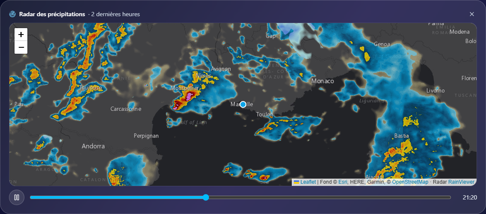

<div align="center">


# Meteora

**La météo en temps réel, claire et installable sur votre téléphone.**

[](https://github.com/romainroussel29/meteora/actions/workflows/ci.yml)


[](./LICENSE)

### [🌐 Ouvrir la démo](https://meteora-ten-sooty.vercel.app)

</div>

---

## 📸 Aperçu

<table>
  <tr>
    <td width="70%" align="center"><br /><sub>Ordinateur : météo actuelle, pluie dans l'heure, 24 h et détail d'un jour toutes les 2 h</sub></td>
    <td width="30%" align="center"><br /><sub>iPhone</sub></td>
  </tr>
  <tr>
    <td colspan="2" align="center"><br /><sub>Radar des précipitations animé</sub></td>
  </tr>
</table>

---

## ✨ Fonctionnalités

| | |
| --- | --- |
| 🌡️ **Météo actuelle** | Température, ressenti, risque de pluie, min / max, lever et coucher du soleil |
| ☔ **Pluie dans l'heure** | Une alerte n'apparaît que si de la pluie arrive : « Pluie modérée prévue vers 17h15 », « Pluie en cours, fin prévue vers 18h00 »… grâce aux données au quart d'heure |
| 🧭 **Vent** | Boussole avec flèche orientée, taille et couleur selon la force (vent faible, modéré, fort… d'après l'échelle de Beaufort) |
| ⏱️ **24 heures** | Courbe de température, gouttelettes de pluie et vent heure par heure, défilement au doigt sur mobile |
| 📅 **7 jours** | Températures min / max à l'échelle de la semaine ; un clic ouvre le détail **toutes les 2 h** |
| 🗺️ **Radar** | Carte radar animée de la pluie observée sur les 2 dernières heures. Boutons « recentrer », zoom + / − et niveaux Ville / Région / Pays. Ouverte d'un clic depuis la météo actuelle |
| 🎨 **Fond animé** | Soleil, étoiles, nuages, pluie, neige, orage ou brouillard selon la météo réelle, dans un bandeau discret en haut de la page, avec des teintes d'aube et de crépuscule autour du lever et du coucher du soleil |
| 📍 **Géolocalisation** | Météo du lieu où l'on se trouve en un clic (aucune demande d'autorisation à l'ouverture), avec le vrai nom de la ville |
| 🔎 **Recherche** | Autocomplétion des villes, utilisable entièrement au clavier |
| ⭐ **Favoris** | Villes favorites avec leur **température et leur temps en direct**, dernière ville mémorisée (Marseille par défaut) |
| 🔄 **Actualisation** | Automatique toutes les heures (et au retour dans l'application), **tirer vers le bas pour actualiser** sur mobile |
| 📱 **Application** | Installable sur iPhone, Android et ordinateur, fonctionne hors ligne |

> 💡 Pour voir les fonds animés sans attendre la bonne météo, ajoutez `?meteo=` à l'adresse :
> [`?meteo=neige`](https://meteora-ten-sooty.vercel.app/?meteo=neige) ·
> [`?meteo=orage`](https://meteora-ten-sooty.vercel.app/?meteo=orage) ·
> [`?meteo=pluie`](https://meteora-ten-sooty.vercel.app/?meteo=pluie) ·
> [`?meteo=nuit`](https://meteora-ten-sooty.vercel.app/?meteo=nuit) ·
> [`?meteo=brouillard`](https://meteora-ten-sooty.vercel.app/?meteo=brouillard)

---

## 📱 Installer l'application

Meteora est une **PWA** (*Progressive Web App*) : elle s'installe directement depuis le navigateur, sans passer par un store.

| Appareil | Marche à suivre |
| --- | --- |
| **iPhone / iPad** | Ouvrir le site dans **Safari** → **Partager** → **Sur l'écran d'accueil** |
| **Android** | Ouvrir le site dans **Chrome** → menu **⋮** → **Installer l'application** |
| **Ordinateur** | Dans Chrome ou Edge, cliquer sur l'icône d'installation de la barre d'adresse |

Une fois installée, l'application s'ouvre en plein écran et affiche les dernières prévisions même sans connexion.

---

## 🛠️ Points techniques

Ce projet fait partie de mon portfolio. Voici les choix techniques qui me semblaient importants :

- **TypeScript strict** : toutes les réponses d'API, props et hooks sont typés (`src/types/weather.ts`), sans `any`.
- **Hooks personnalisés** : `useWeather` (chargement, erreurs, actualisation), `useFavorites`, `useFavoritesWeather` et `useOnlineStatus` (avec `useSyncExternalStore`) gardent les composants simples.
- **Requêtes robustes** : vérification des erreurs HTTP et annulation des requêtes obsolètes avec `AbortController`. Une réponse lente ne peut jamais écraser une recherche plus récente. La météo de tous les favoris est récupérée **en une seule requête**.
- **Cache des appels API** (`src/utils/cache.ts`, fait maison) : mémoire + `localStorage`, durée de validité adaptée à chaque donnée, requêtes simultanées dédoublonnées. Un lieu situé **à moins de 5 km à vol d'oiseau** (formule de haversine) d'un lieu déjà chargé réutilise ses prévisions sans nouvel appel.

  | Donnée | Validité | Réutilisée dans un rayon de |
  | --- | --- | --- |
  | Prévisions | 10 min | 5 km |
  | Météo des favoris | 10 min | 5 km (seuls les favoris manquants sont demandés) |
  | Recherche de villes | 24 h | — |
  | Nom de la ville d'une position | 7 jours | 2 km |
  | Images radar | 5 min | — |

  Tirer pour actualiser et le bouton « Actualisé à » contournent le cache pour obtenir des données fraîches.
- **Actualisation intelligente** : vérification chaque minute et à chaque retour au premier plan (`visibilitychange`), car iOS suspend les minuteurs des applications en arrière-plan. Le « tirer pour actualiser » est fait maison avec les événements tactiles (seuil, résistance, verrouillage vertical).
- **Performance** : la carte radar (Leaflet, ~150 Ko) est découpée dans un fichier à part (`React.lazy`) et n'est téléchargée que si on l'ouvre. Courbe de température en SVG et animations en CSS pur, sans librairie, limitées à un bandeau en haut de page pour rester agréables à l'œil.
- **Accessibilité** : pattern ARIA *combobox* pour la recherche (↑ ↓, Entrée, Échap), contrastes vérifiés, noms accessibles explicites, respect du réglage « réduire les animations ». **Lighthouse : 100 en accessibilité** sur mobile et ordinateur.
- **PWA** : manifeste, icônes, *service worker* écrit à la main (cache de l'application, réseau d'abord pour la météo, secours hors ligne), prise en compte de l'encoche de l'iPhone.

### Tests et qualité

| Niveau | Outil | Ce qui est vérifié |
| --- | --- | --- |
| Unitaires | Vitest | Logique métier : vent, pluie dans l'heure, découpage horaire, actualisation, appels API simulés… |
| Composants | React Testing Library | Recherche au clavier, ouverture d'un jour, favoris, carte météo, comme un utilisateur le ferait |
| Bout en bout | Playwright | Parcours complets dans un vrai navigateur, sur ordinateur **et** mobile, avec des API simulées |
| Continue | GitHub Actions | Lint, typage, tests et build, puis tests Playwright, à chaque push |

**Lighthouse** (version de production) :

| | Performance | Accessibilité | Bonnes pratiques | Référencement |
| --- | :---: | :---: | :---: | :---: |
| 📱 Mobile | 97 | 100 | 100 | 100 |
| 💻 Ordinateur | 100 | 100 | 100 | 100 |

### Stack

| Domaine | Outils |
| --- | --- |
| Interface | React 19, TypeScript, Tailwind CSS 4, Lucide React, Leaflet |
| Build | Vite |
| Tests et qualité | Vitest, React Testing Library, Playwright, ESLint (typescript-eslint), GitHub Actions |
| Données | [Open-Meteo](https://open-meteo.com/) (prévisions, pluie au quart d'heure, recherche de villes, sans clé d'API), [RainViewer](https://www.rainviewer.com/) (radar), [Nominatim / OpenStreetMap](https://nominatim.org/) (nom de la ville à partir de la position), fond de carte [Esri](https://www.esri.com/) |
| Hébergement | Vercel (déploiement automatique à chaque push) |

---

## 🚀 Lancer le projet en local

**Prérequis :** Node.js 22 ou plus récent.

```bash
git clone https://github.com/romainroussel29/meteora.git
cd meteora
npm install
npm run dev
```

L'application est alors disponible sur `http://localhost:5173`.

| Commande | Description |
| --- | --- |
| `npm run dev` | Serveur de développement |
| `npm test` | Tests unitaires et de composants |
| `npm run test:watch` | Tests en mode surveillance |
| `npm run test:e2e` | Tests de bout en bout (Playwright) |
| `npm run typecheck` | Vérification des types TypeScript |
| `npm run lint` | Analyse du code avec ESLint |
| `npm run build` | Vérification des types + version de production |
| `npm run preview` | Aperçu de la version de production (avec le mode hors ligne) |

> Pour les tests Playwright, installez une fois le navigateur avec `npx playwright install chromium` (ou utilisez Google Chrome s'il est déjà installé).

---

## 📂 Structure du projet

```text
src/
├── components/     # Interface : météo actuelle, 24 h, 7 jours, radar, recherche, favoris, fond animé…
│   └── __tests__/  # Tests de composants (React Testing Library)
├── hooks/          # useWeather, useFavorites, useFavoritesWeather, useOnlineStatus
├── types/          # Types TypeScript des données météo
├── utils/          # API, pluie dans l'heure, géolocalisation, vent, icônes, découpage horaire…
│   └── __tests__/  # Tests unitaires (Vitest)
├── test/           # Configuration des tests et jeu de données fictif
├── App.tsx         # Assemblage de l'interface
└── main.tsx        # Point d'entrée + enregistrement du service worker
e2e/                # Tests de bout en bout (Playwright)
public/
├── manifest.webmanifest   # Description de l'application installable
├── sw.js                  # Service worker (cache et hors ligne)
└── icons/                 # Icônes de l'application
```

---

## 👤 Auteur

**Romain Roussel**, développeur web
[GitHub @romainroussel29](https://github.com/romainroussel29)

Projet sous licence [MIT](./LICENSE).

<sub>Données météo : [Open-Meteo](https://open-meteo.com/) · Radar : [RainViewer](https://www.rainviewer.com/) · Fond de carte : Esri · Géocodage © contributeurs [OpenStreetMap](https://www.openstreetmap.org/copyright)</sub>
